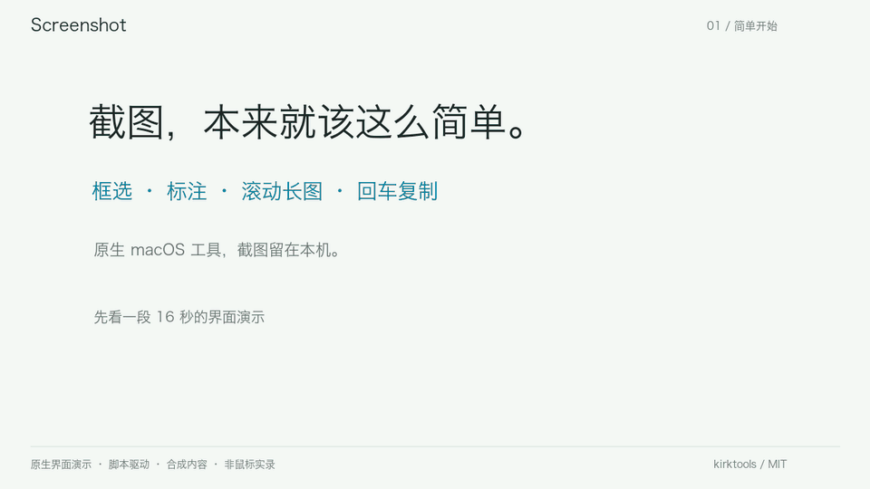

# Screenshot

[简体中文](README.md)

A lightweight, native macOS screenshot tool. Capture a region, scroll to stitch a long image, and press Return to copy—without opening WeChat.

[Download the latest release](https://github.com/kirktools/screenshot/releases/latest)

- **Scrolling screenshots:** scroll downward manually; overlapping content is matched and stitched automatically.
- **In-place annotation:** arrows, rectangles, ellipses, text, crop, and redaction.
- **Quick capture:** lives in the menu bar, with configurable global shortcuts.
- **Local processing:** no account, no screenshot uploads. Copy the final image or save a PNG.

## Use

1. Press **⌘⇧2** for a region or **⌘⇧7** for scrolling capture. Shortcuts can be changed in Settings; system conflicts may require a different combination.
2. Select a region. For a long capture, select the scrollable content and scroll down in the original app.
3. Press **Return** to copy and finish, or **Esc** to cancel. Choose the pencil to edit a long image or the download button to save it.

[MP4 version](docs/images/screenshot-intro.mp4) · Native UI with synthetic content, driven by a script rather than a recording of mouse interactions.

## Install

Requires **macOS 14+**, Apple Silicon or Intel. Download the DMG from Releases and drag Screenshot into Applications. Screen Recording permission is required; Accessibility and microphone permissions are not.

Current releases are not Apple Developer ID signed or notarized. macOS may block a download; verify its source and follow the system's prompts. Do not disable Gatekeeper or SIP. See the [installation guide](docs/USAGE.md#安装与权限) and [signing notes](docs/SIGNING.md).

For local development, run `make dev` (Swift 6+, Command Line Tools, Python 3). This installs a separate **Screenshot Dev** with independent settings and permissions; it does not replace the daily app.

## Limits and privacy

Scrolling capture works best with static content. Fixed headers, floating elements, animations, dynamic messages, repeated patterns, and fast jumps can prevent a reliable match. Upward extension and scrolling capture across displays are not supported. When matching fails, the app offers recovery or undo instead of silently assuming a correct result.

All image processing happens locally. GitHub is contacted when you explicitly check for or download an update. See [Privacy](docs/PRIVACY.md).

The documentation images and animation use generated example content, not private conversations.

## Contribute

Bug reports and pull requests are welcome. Include the system version and reproduction steps, and use non-sensitive screenshots. See [Contributing](CONTRIBUTING.md), [Architecture](docs/ARCHITECTURE.md), and [Security](SECURITY.md).

[MIT](LICENSE) · Copyright © 2026 kirktools
