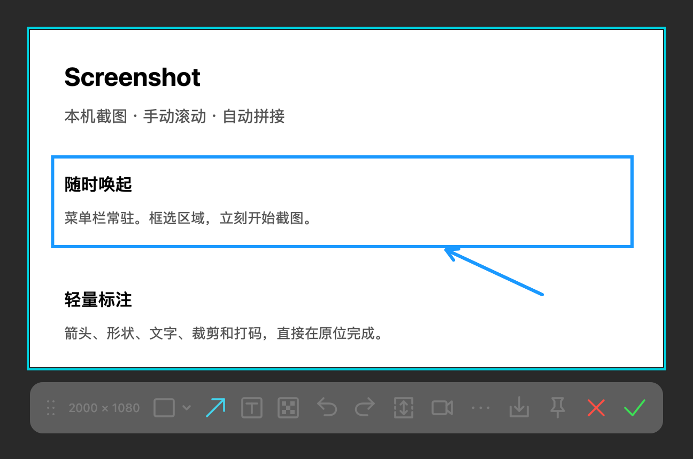
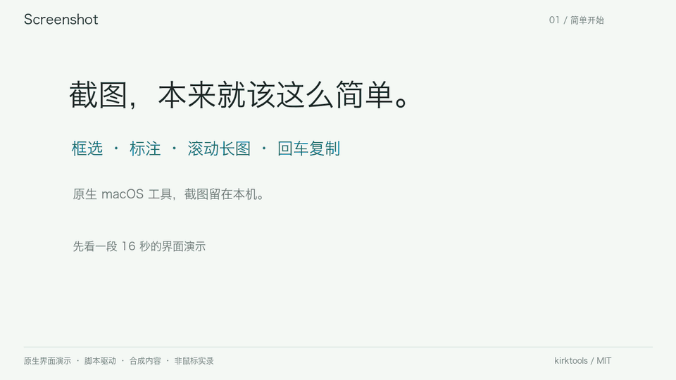

# Screenshot

A lightweight, native macOS capture tool. **One selection for screenshots, scrolling captures, and GIFs.**

[Website](https://kirktools.github.io/screenshot/) · [Download](https://github.com/kirktools/screenshot/releases/latest) · [简体中文](README.md)



- **Region capture:** hover to select a window, drag a region, adjust its edges, and annotate in place.
- **Scrolling screenshots:** scroll up or down manually; automatic overlap matching and deduplication. Stable top/bottom bars appear once. Preview, undo, and recovery are available.
- **GIF recording:** reuse the selected region, start/stop manually, preview, and save.
- **Editable text:** move and re-edit text, drag corners to scale, use the rotation handle, or enter precise size, angle, and opacity. Arrows, shapes, solid redaction, crop, and undo/redo remain available.
- **Pinned references:** keep the rendered image above other windows, move or resize it. The capture toolbar can be moved too.
- **Local processing:** no account or screenshot uploads. Copy/save PNGs, check for updates, and optionally enable local timing diagnostics in Settings.

## Use

1. Press **⌘⇧2** and select a region or window.
2. Annotate directly, or choose scrolling capture, GIF recording, or pinning from the toolbar.
3. **Return / ✓** copies and finishes a screenshot; **Esc / ×** cancels. Stop a GIF to preview and save it.

Disable the separate scrolling shortcut in Settings to use only one global shortcut, or keep **⌘⇧7** for direct scrolling capture. Shortcuts are configurable.



[MP4](docs/images/screenshot-intro.mp4) · Native UI and synthetic content, script-driven rather than a recording of mouse interactions.

## Install

Requires **macOS 14+**, Apple Silicon or Intel. Download the DMG and drag Screenshot into Applications. Screen Recording permission is required; Accessibility and microphone permissions are not.

Current releases are not Apple Developer ID signed or notarized. Verify the download source and follow macOS prompts; do not disable Gatekeeper or SIP. See the [installation guide](docs/USAGE.md#安装与权限).

For development or PR testing (Swift 6+, Command Line Tools, Python 3):

```sh
make dev
```

This updates a separate **Screenshot Dev**, with independent permissions and settings and default shortcuts **⌃⌥2 / ⌃⌥7**. It does not replace the daily app. This README describes current source capabilities; available downloads follow their [release notes](https://github.com/kirktools/screenshot/releases/latest).

## Limits and privacy

Scrolling capture works best with static, vertically scrolling content. Stable bars near the top/bottom can be separated; central overlays, animations, dynamic messages, reflow, repeated patterns, and fast jumps may prevent a reliable match. Horizontal and cross-display scrolling captures are unsupported. There is no fixed height limit, but memory and pixel budgets still apply.

GIF recording is limited to 60 seconds, up to 10 fps and 1280 pixels on the longest edge; no audio or cursor capture. All image processing is local. GitHub is contacted for explicit update checks/downloads. Timing diagnostics are local and optional. See [Privacy](docs/PRIVACY.md) and [Usage](docs/USAGE.md).

## Contribute

Issues and PRs are welcome. Include your system version, reproduction steps, and non-sensitive examples. See [Contributing](CONTRIBUTING.md), [Architecture](docs/ARCHITECTURE.md), and [Security](SECURITY.md).

[MIT](LICENSE) · Copyright © 2026 kirktools
