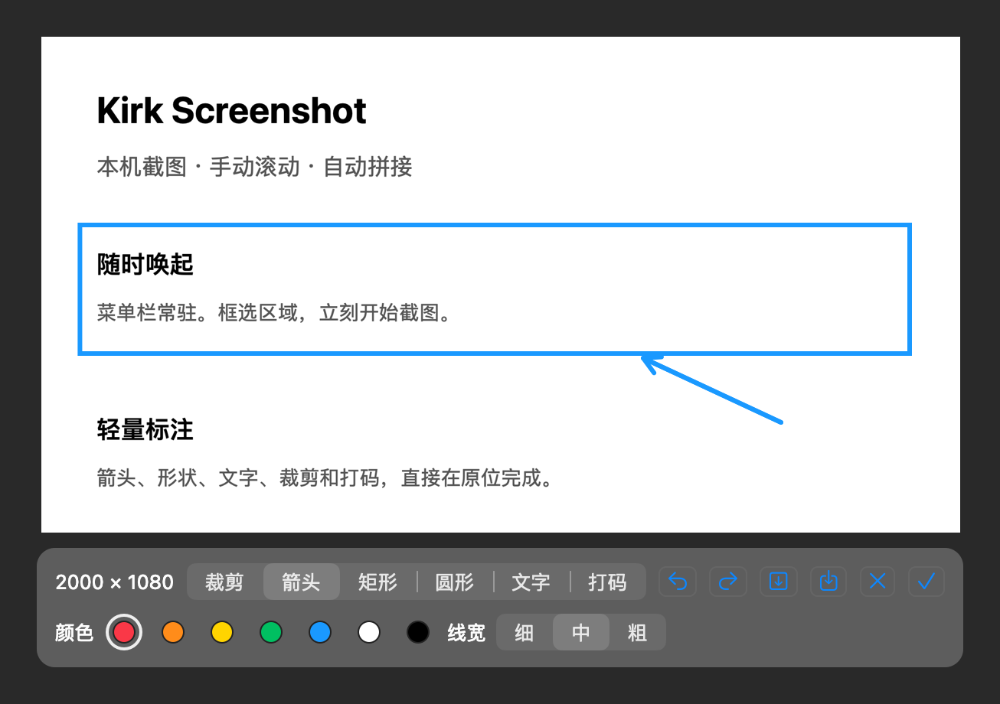
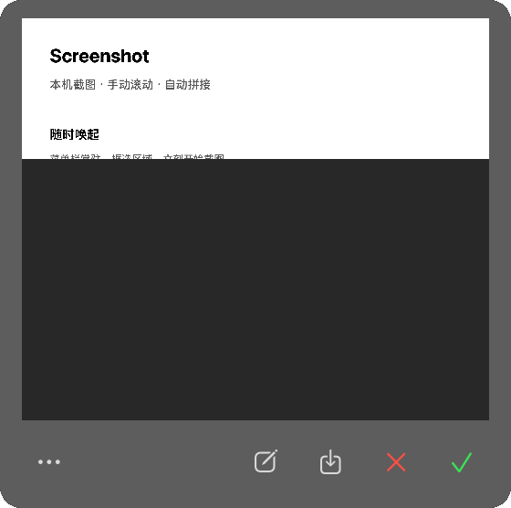
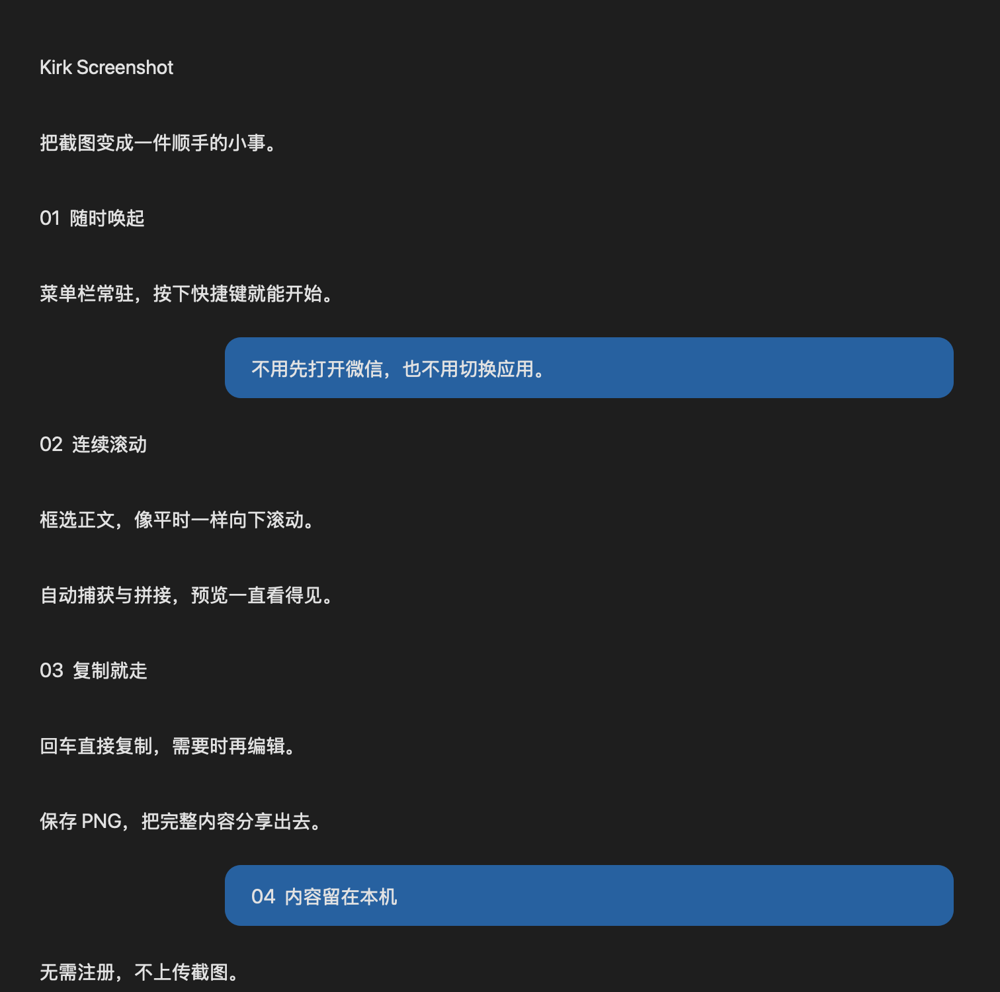

# Kirk Screenshot

独立、轻巧的原生 macOS 截图工具。框选、滚动、复制，不必打开微信。

**原生体验 · 本机处理 · 无需账号**



## 能做什么

- **区域截图**：框选后可拖边框调整、直接标注，支持箭头、矩形、圆形、文字、裁剪和打码。
- **滚动长图**：手动向下滚动，自动拼接；常驻预览，回车直接复制。
- **随时唤起**：菜单栏常驻，全局快捷键可配置。
- **留在本机**：不注册、不上传，复制或保存为 PNG。

## 怎么用

1. 按 **⌘⇧2** 普通截图，或 **⌘⇧7** 截长图，移动鼠标预选窗口，单击确认；也可拖动框选区域。
2. 普通截图直接标注；长截图在原应用中向下滚动，预览自动更新。
3. **回车 / ✓ 复制并结束**，**Esc / × 取消**。长图需要编辑时点铅笔，保存时点下载图标。

长图界面只保留预览和图标，出错才显示悬浮提示。撤销、重试、放大等操作在「…」里。

 

<sub>界面由真实原生控件渲染；示例内容为生成素材，不含私人聊天。</sub>

## 安装运行

支持 **macOS 14+**，Apple Silicon / Intel。新版本提供 DMG 安装包：打开后将应用拖入 Applications。也保留 ZIP；旧版没有 DMG 时可使用 ZIP。

本地验收 PR：切到对应代码后运行 `make dev`，自动更新并启动 `/Applications/Kirk Screenshot.app`，设置中可核对分支和提交。详见[本地测试](docs/USAGE.md#本地验收-pr)。

从源码构建（Swift 6.0+）：

```bash
make dev
```

统一安装到 `/Applications/Kirk Screenshot.app`，避免多份同名应用。首次截图需授予**屏幕录制**权限，不需要辅助功能或麦克风权限。

当前应用尚未 Developer ID 签名及公证；下载包可能被 macOS 拦截，请按系统提示核验来源，勿关闭系统安全保护。详见[安装与权限](docs/USAGE.md#安装与权限)。

## 使用边界

长图适合静态、向下滚动的正文。框选时避开固定栏、输入框和悬浮按钮；动态消息、动画、快速跳页或重复内容可能无法接续。暂不支持向上扩展及跨屏长图，不保证适配所有应用。

## 文档与贡献

[使用与排障](docs/USAGE.md) · [架构](docs/ARCHITECTURE.md) · [测试验收](docs/ACCEPTANCE.md) · [CI 与发布](docs/RELEASING.md)

欢迎 Issue 和 PR：请附系统版本、芯片与复现步骤，图片使用非敏感示例。修改算法请补测试，修改界面请附截图。

[MIT](LICENSE) · Copyright © 2026 kirktools
