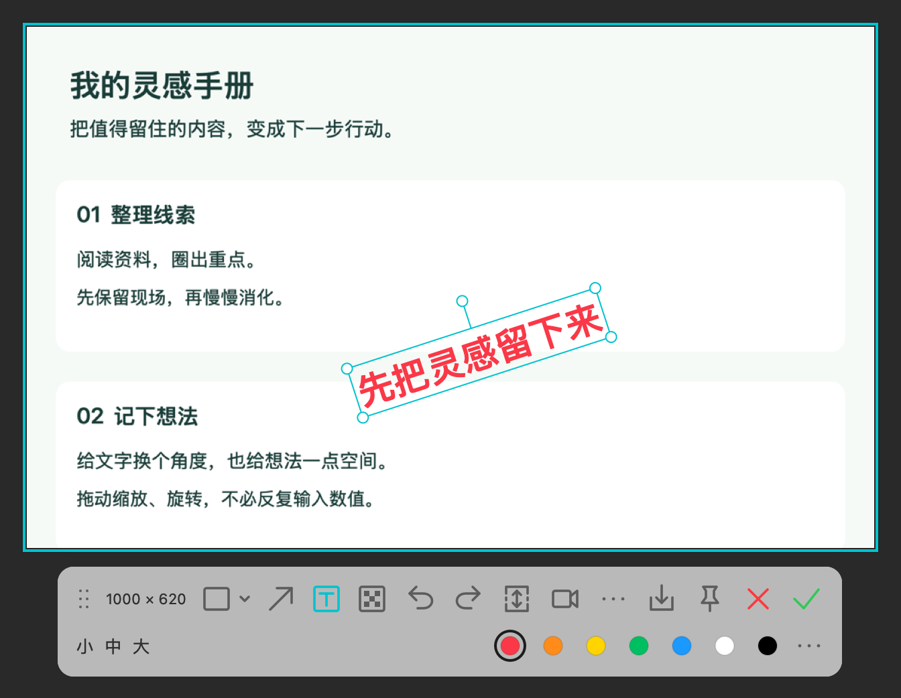
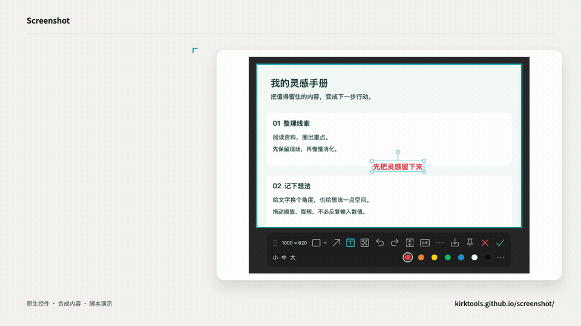

# Screenshot

独立、轻巧的原生 macOS 截图工具。**一次框选，截图、长图、GIF 都能做。**

原生体验 · 本机处理 · 无需账号

[官网](https://kirktools.github.io/screenshot/) · [下载正式版](https://github.com/kirktools/screenshot/releases/latest) · [English](README.en.md)



## 能做什么

- **区域截图**：预选窗口、拖动框选、调整边框，直接在原位标注。
- **滚动长图**：手动上下滚动，自动拼接去重；稳定的顶栏、底栏只保留一次，常驻预览，支持撤销与接续。
- **GIF 录制**：复用截图选区，手动开始/停止，预览后保存。
- **文字与标注**：箭头、矩形、圆形、实心打码；文字可重新编辑、移动，拖动角点缩放、手柄旋转，也能精确调字号和透明度。
- **贴图参考**：钉到屏幕，拖动移动、等比缩放；工具栏也能拖开，避免挡住内容。
- **留在本机**：截图不上传，不需要账号。复制、保存 PNG，应用内检查更新；耗时诊断可在设置中开关。

## 怎么用

1. 按 **⌘⇧2**，预选窗口或拖动框选。
2. 直接标注，或点工具栏的**长截图 / 摄像机 / 图钉**。长图在原应用滚动；GIF 点击开始录制。
3. 截图按 **回车 / ✓** 复制并结束，**Esc / ×** 取消。GIF 停止后预览、保存。

只想占用一组快捷键？在设置中关闭“长截图独立快捷键”即可；也可保留 **⌘⇧7** 直接唤起长截图。快捷键均可配置。



[观看 MP4](docs/images/features-demo.mp4) · <sub>18 秒 · 配乐版 · 文字缩放旋转、固定栏长图、GIF 录制与贴图。原生控件和合成内容，脚本驱动，非鼠标实录。</sub>

## 安装运行

支持 **macOS 14+ · Apple Silicon / Intel**。下载 DMG，将应用拖入 Applications。首次采集需授予**屏幕录制**权限，不需要辅助功能或麦克风权限。

当前未完成 Apple Developer ID 签名及公证，下载包可能被 macOS 拦截。确认来源后按系统提示处理，不要关闭系统安全保护。详见[安装与权限](docs/USAGE.md#安装与权限)。

从源码运行，或切到 PR 分支验收（Swift 6+、Command Line Tools、Python 3）：

```sh
make dev
```

安装并启动独立的 **Screenshot Dev**，不覆盖日常版；默认快捷键 **⌃⌥2 / ⌃⌥7**，配置与权限独立。本文介绍当前源码能力，下载的正式版以 [Release 说明](https://github.com/kirktools/screenshot/releases/latest)为准。

## 使用边界

长图适合静态、垂直滚动的正文；固定栏需稳定且靠近顶部/底部。中央遮挡、动画、动态消息、重排及重复纹理可能无法接续，不保证适配所有应用，不支持水平或跨屏长图。无固定高度门槛，仍受内存与总像素预算约束。

GIF 最高 10 fps、最长 60 秒、最长边 1280 像素，不录声音或光标。完整限制见[使用说明](docs/USAGE.md)。

## 文档与贡献

[使用与排障](docs/USAGE.md) · [隐私](docs/PRIVACY.md) · [安全报告](SECURITY.md) · [贡献指南](CONTRIBUTING.md) · [架构](docs/ARCHITECTURE.md) · [验收](docs/ACCEPTANCE.md) · [CI 与发布](docs/RELEASING.md)

欢迎 Issue 和 PR。请附系统版本与复现步骤，图片使用非敏感示例；算法修改补测试，界面修改附截图。

[MIT](LICENSE) · Copyright © 2026 kirktools
